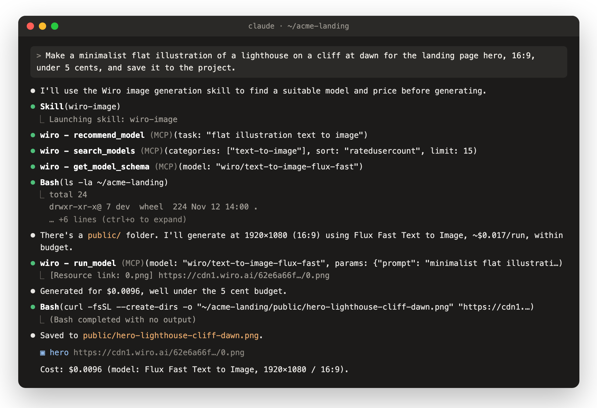
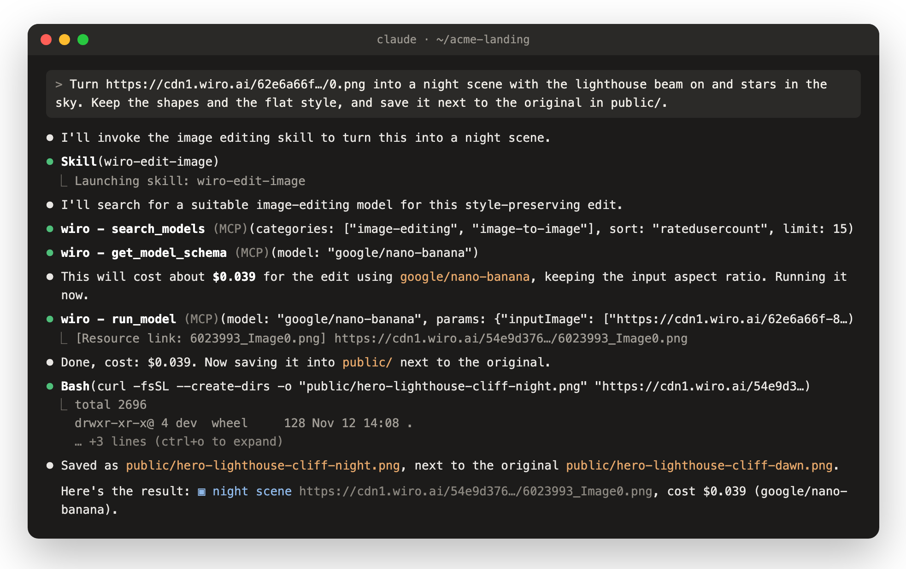

<div align="center">


# Wiro AI skills

Agent skills that make images, image edits, videos, music, voice-overs, transcripts and 3D models with Wiro AI, and find the right model and price in a catalog of 1,000+ models.

[](./LICENSE) [](#install) [](https://wiro.ai/docs/wiro-mcp-server)

[Website](https://wiro.ai) · [Models](https://wiro.ai/models) · [Docs](https://wiro.ai/docs/wiro-mcp-server) · [Dashboard](https://wiro.ai/panel)

</div>

Each skill is a `SKILL.md` file that shows your agent how to do one job with the tools of the hosted Wiro MCP server: pick a fitting model from the catalog, tell you the price before it runs, run it and hand you the files. They work in Claude Code, Codex, Cursor, Gemini CLI, GitHub Copilot, OpenClaw and the many other agents that read skills.

## Skills

| Skill | What it does |
| --- | --- |
| [`wiro-image`](./skills/wiro-image/SKILL.md) | Generates images from a prompt |
| [`wiro-edit-image`](./skills/wiro-edit-image/SKILL.md) | Edits an image: a new style, things added or removed, the background removed, or a sharper, larger version |
| [`wiro-video`](./skills/wiro-video/SKILL.md) | Makes a video from text, or animates a start image |
| [`wiro-music`](./skills/wiro-music/SKILL.md) | Makes an instrumental track or a song with lyrics |
| [`wiro-speech`](./skills/wiro-speech/SKILL.md) | Turns text into natural speech or a voice-over |
| [`wiro-transcribe`](./skills/wiro-transcribe/SKILL.md) | Turns audio or video into text, captions or subtitles |
| [`wiro-3d`](./skills/wiro-3d/SKILL.md) | Turns a photo or a description into a 3D model file |
| [`wiro-models`](./skills/wiro-models/SKILL.md) | Searches and compares models, their inputs and their prices, without running anything |

## See it run

Claude Code with the `wiro-image` skill: it picks a model from the catalog, checks the price against the budget, runs it and saves the file into the project.




Then `wiro-edit-image` turns the same picture into a night scene:




Both are real runs; long tool output is shortened.

## Install

With [skills.sh](https://skills.sh), for Claude Code, Codex, Cursor, Gemini CLI, GitHub Copilot and other agents:

```bash
npx skills add wiroai/Wiro-Skills
```

The command asks which skills to add and for which agents. To add one skill:

```bash
npx skills add wiroai/Wiro-Skills --skill wiro-image
```

With [ClawHub](https://clawhub.ai/wiroai), for OpenClaw:

```bash
openclaw skills install @wiroai/wiro-image
```

You can also copy a folder from `skills/` into your agent's skills folder, such as `.claude/skills/` for Claude Code.

## Connect the Wiro MCP server

The skills use the tools of the hosted Wiro MCP server at `https://mcp.wiro.ai/v1`. Add it once.

In Claude Code:

```bash
claude mcp add --transport http wiro https://mcp.wiro.ai/v1
```

Then open `/mcp`, select `wiro` and choose Authenticate. The Wiro sign-in page opens in your browser: sign in or create an account, pick a project and click Allow. The project you pick decides which wallet pays for runs.

Any other client that supports remote MCP servers can connect to the same URL. Clients with MCP sign-in (OAuth) open the Wiro sign-in page. Others can send an `Authorization: Bearer <API key>` header; for a project that uses signature-based auth, send `API_KEY:API_SECRET`. Setup guides for more clients are in the [Wiro MCP docs](https://wiro.ai/docs/wiro-mcp-server).

The [Wiro AI plugin](https://github.com/wiroai/Wiro-Plugin) adds the server for you in Claude Code, Cursor, Gemini CLI, Devin, Antigravity and Kiro, together with slash commands that do the same jobs as these skills.

## How they work

- The skill searches the catalog and reads the model's inputs and price first. These calls are free.
- Before a paid run, it writes one line with the model, the settings that change the price and the expected cost, and names one or two alternatives. It goes ahead when you asked for exactly that and the estimate is 1 USD or less. Otherwise it asks first.
- It waits for the task to finish, shows images inline when it can, gives a link to every file and reports the cost.
- It saves files into your project only when you ask, and never overwrites a file that is already there.

## Try it

- "Make three square images of a lighthouse at dawn, in watercolor"
- "Remove the background from this product photo and make it 2K"
- "Animate hero.png into a five second clip with slow camera motion"
- "Make a calm 30 second piano track for a product video"
- "Read this paragraph aloud in a warm voice and save it to public/audio/"
- "Transcribe meeting.mp4 with timestamps as an SRT file"
- "Turn this photo of a chair into a GLB"
- "Which text to video models on Wiro have sound, and what does each cost?"

## Pricing

The skills and the connection are free. Each model run is paid from your Wiro wallet at the model's listed price, and the skill tells you the expected cost before each run.

## How this repository is built

The skills come from the same sources as the slash commands of the Wiro AI plugin: `src/commands/` and `src/partials/` in [wiroai/Wiro-Plugin](https://github.com/wiroai/Wiro-Plugin). To change a skill, edit its source there, then run this next to a checkout of Wiro-Plugin:

```bash
node scripts/build.mjs --plugin ../Wiro-Plugin
```

CI fails when the skills here differ from those sources.

## More Wiro AI skills

| Skill | Repository | What it covers |
| --- | --- | --- |
| `wiro-ai` | [Wiro-Plugin](https://github.com/wiroai/Wiro-Plugin) | Wiro AI from code: find a model, check its price, run it, get the result and call LLMs |
| `wiro-media-assets` | [Wiro-Plugin](https://github.com/wiroai/Wiro-Plugin) | Images, social cards, icons, short videos, voice-overs and 3D models for a project, placed where its framework expects them |
| `wiro-workflows` | [Wiro-Plugin](https://github.com/wiroai/Wiro-Plugin) | Workflows: design, save, run, test and repair them |
| `wiro-agents` | [Wiro-Plugin](https://github.com/wiroai/Wiro-Plugin) | Wiro AI agents: plans and prices, deploying, messages and scheduled tasks |
| `wiro-realtime-voice` | [Wiro-Plugin](https://github.com/wiroai/Wiro-Plugin) | Live voice conversation, streaming text to speech and speech to text |
| `wiro-llm` | [Wiro-LLM](https://github.com/wiroai/Wiro-LLM) | The Wiro LLM gateway with OpenAI- and Anthropic-compatible APIs |
| `wiro-flutter` | [Dart-QuickStart](https://github.com/wiroai/Dart-QuickStart) | Flutter and Dart apps on the Wiro AI SDK |
| `wiro-react-native` | [ReactNative-QuickStart](https://github.com/wiroai/ReactNative-QuickStart) | React Native and Expo apps on the Wiro AI SDK |
| `wiro-swift` | [Swift-QuickStart](https://github.com/wiroai/Swift-QuickStart) | iOS and SwiftUI apps on WiroKit |
| `wiro-kotlin` | [Kotlin-QuickStart](https://github.com/wiroai/Kotlin-QuickStart) | Android and Kotlin apps on WiroKit |
| `wiro-n8n` | [n8n-nodes-wiroai](https://github.com/wiroai/n8n-nodes-wiroai) | Wiro AI nodes in n8n workflows |
| `wiro-github-action` | [Wiro-Action](https://github.com/wiroai/Wiro-Action) | GitHub Actions workflows that call Wiro AI |
| `wiro-nextjs` | [Wiro-Next-Starter](https://github.com/wiroai/Wiro-Next-Starter) | Next.js App Router features on Wiro AI |

## Support, terms and privacy

Email [support@wiro.ai](mailto:support@wiro.ai) or open an issue in this repository. Use of Wiro AI through these skills is covered by the Wiro AI [Terms of Service](https://wiro.ai/agreement/terms-of-service) and [Privacy Policy](https://wiro.ai/agreement/privacy-policy).

## More from Wiro AI

| Repository | What it is |
| --- | --- |
| [Wiro-Plugin](https://github.com/wiroai/Wiro-Plugin) | Wiro AI plugin for Claude Code, Cursor, Gemini CLI, Devin, Antigravity and Kiro |
| [Wiro-MCP](https://github.com/wiroai/Wiro-MCP) | Official MCP server for Wiro AI, [`@wiro-ai/wiro-mcp` on npm](https://www.npmjs.com/package/@wiro-ai/wiro-mcp) |
| [Wiro-LLM](https://github.com/wiroai/Wiro-LLM) | Vercel AI SDK provider for chat, images, speech, transcription and video, [`@wiro-ai/wiro-llm` on npm](https://www.npmjs.com/package/@wiro-ai/wiro-llm) |
| [Wiro-Chromium-Extension](https://github.com/wiroai/Wiro-Chromium-Extension) | Wiro AI extension for Chrome, Edge, Opera and Brave |
| [Wiro-Firefox-Extension](https://github.com/wiroai/Wiro-Firefox-Extension) | Wiro AI add-on for Firefox |
| [Wiro-Safari-Extension](https://github.com/wiroai/Wiro-Safari-Extension) | Wiro AI extension for Safari on the Mac |
| [Swift-QuickStart](https://github.com/wiroai/Swift-QuickStart) | WiroKit, the Wiro AI SDK for iOS |
| [Kotlin-QuickStart](https://github.com/wiroai/Kotlin-QuickStart) | WiroKit, the Wiro AI SDK for Android |
| [Dart-QuickStart](https://github.com/wiroai/Dart-QuickStart) | Wiro AI SDK for Dart and Flutter, [`wiro` on pub.dev](https://pub.dev/packages/wiro) |
| [ReactNative-QuickStart](https://github.com/wiroai/ReactNative-QuickStart) | Wiro AI SDK for React Native and Expo, [`@wiro-ai/wiro-react-native` on npm](https://www.npmjs.com/package/@wiro-ai/wiro-react-native) |
| [n8n-nodes-wiroai](https://github.com/wiroai/n8n-nodes-wiroai) | Wiro AI nodes for n8n, [`@wiro-ai/n8n-nodes-wiroai` on npm](https://www.npmjs.com/package/@wiro-ai/n8n-nodes-wiroai) |
| [n8n-nodes-wiro](https://github.com/wiroai/n8n-nodes-wiro) | One Wiro AI node for n8n with a searchable model picker, [`@wiro-ai/n8n-nodes-wiro` on npm](https://www.npmjs.com/package/@wiro-ai/n8n-nodes-wiro) |
| [Wiro-Dify-Plugin](https://github.com/wiroai/Wiro-Dify-Plugin) | Wiro AI plugins for Dify: the LLM gateway as a model provider, plus image, video, speech and music tools |
| [Wiro-ComfyUI](https://github.com/wiroai/Wiro-ComfyUI) | Wiro AI nodes for ComfyUI |
| [Wiro-Hermes](https://github.com/wiroai/Wiro-Hermes) | Wiro AI plugins for Hermes Agent: image, video, audio and 3D tools, plus the LLM gateway as a model provider |
| [Wiro-Zed](https://github.com/wiroai/Wiro-Zed) | Wiro AI MCP server extension for Zed |
| [Wiro-Action](https://github.com/wiroai/Wiro-Action) | GitHub Action for Wiro AI models and the LLM gateway, [on the GitHub Marketplace](https://github.com/marketplace/actions/wiro-ai-action) |
| [Wiro-Raycast](https://github.com/wiroai/Wiro-Raycast) | Wiro AI extension for Raycast: image and video generation, LLM chat and model search |
| [Wiro-WordPress](https://github.com/wiroai/Wiro-WordPress) | Wiro AI plugin for WordPress: featured images, image edits, alt text, narration and SEO suggestions |
| [Wiro-Obsidian](https://github.com/wiroai/Wiro-Obsidian) | Wiro AI plugin for Obsidian: images, video, speech, music, transcription and text tools |
| [Wiro-Blender](https://github.com/wiroai/Wiro-Blender) | Wiro AI add-on for Blender: text to 3D, image to 3D and textures |
| [Wiro-Figma](https://github.com/wiroai/Wiro-Figma) | Wiro AI plugin for Figma: images, vectors, image edits and text |
| [Wiro-Next-Starter](https://github.com/wiroai/Wiro-Next-Starter) | Next.js starter for Wiro AI: Playground, image, video and audio tools, and LLM chat, ready for Vercel and Railway |
| [Wiro-Docs](https://github.com/wiroai/Wiro-Docs) | Source of the Wiro AI API docs |

[Website](https://wiro.ai) · [Models](https://wiro.ai/models) · [Docs](https://wiro.ai/docs) · [X](https://x.com/wiroai)

## License

MIT, see [LICENSE](./LICENSE).
